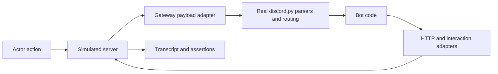

# dpytest redesign: actionable implementation handoff

Status: proposed design; implementation has not started.

Prepared: 2026-10-31. Repository: this dpytest working tree. Source review baseline: locally installed discord.py 2.7.1. Recheck versions and working-tree changes before implementing.

## Objective and release gate

Let a developer test a bot's real message, reaction, command, component, and modal workflows using a short pytest fixture and simulated user actions. Tests must execute the bot's normal discord.py routing and inspect observable results without constructing protocol payloads or manipulating private discord.py objects.

The first release gate is a working integration test of:

1. A user invokes a real registered application command.
2. The bot sends a message containing a registered view.
3. The user clicks a component from that message.
4. The bot opens a modal.
5. The user submits the modal.
6. The bot defers, edits its original response, and sends a followup.
7. The test checks content, visibility, message identity, ordering, and errors.

A separate reaction scenario must exercise both cached and uncached message events, including a bot awaiting a user's reaction with `wait_for`.
All of this must run without Discord credentials or Discord network access. Other application dependencies remain under the bot factory's control.

## Scope and priorities

Prioritize complete conversations over endpoint counts. The existing [coverage inventory](DISCORD_ENDPOINT_COVERAGE.md) is discovery material, not a requirement to emulate all of Discord.

Initial scope:

- Isolated sessions, deterministic IDs, fixture-friendly startup and teardown.
- Text messages, edits, deletes, attachments, reactions, and associated Gateway inputs.
- Application commands, autocomplete, buttons, selects, modal submissions, and interaction responses.
- Original interaction responses, followups, ephemeral visibility, response deadlines, token expiry.
- Transcript queries, bounded asynchronous expectations, task/error reporting.
- An incremental compatibility path for existing dpytest users.

Defer full voice protocol simulation, a networked Discord emulator, exhaustive API permissions, general rate-limit emulation, sharding, arbitrary video/audio, and webhook-based inbound interaction delivery. Keep the backend reusable for future HTTP/WebSocket hosting. Discord HTTP errors relevant to implemented workflows belong in scope.

## Source findings that motivate the change

| Current source | Finding | Implementation consequence |
| --- | --- | --- |
| [runner.py](discord/ext/test/runner.py) | Global configuration, sent/error queues; `run_all_events` scans tasks by `_run_event` coroutine name. | Introduce per-session state, observations, and owned work tracking. |
| [backend.py](discord/ext/test/backend.py) | FakeHttp overrides individual methods; `_get_higher_locs` reads caller frames; unhandled requests raise. | Handle serialized requests using IDs and payloads, not caller-local variables. |
| [backend.py](discord/ext/test/backend.py) | Configuration replaces the client's connection state. | Verify and preserve command-tree, view, modal, and HTTP references during attachment. |
| [state.py](discord/ext/test/state.py) | FakeState inherits discord.py parsers and overrides selected behavior. | Reuse real parsing and routing behind a narrow compatibility layer. |
| [verify.py](discord/ext/test/verify.py) | Assertions largely consume a global sent-message queue. | Add immutable transcript observations and explicit query cursors. |
| [tests/conftest.py](tests/conftest.py) | Fixtures perform private loop setup and global queue cleanup. | Move initialization and lifecycle management into Session. |
| Installed `discord/state.py:814` | `parse_interaction_create` routes commands/autocomplete, views, and modal submissions. | Inject payloads through that route rather than invoking bot callbacks directly. |
| Installed `discord/state.py:259` and `app_commands/tree.py` | CommandTree is associated with ConnectionState; view registrations also live in state. | Freshly replacing state without rebinding is insufficient for interactions. |

These findings are static source observations, not runtime compatibility guarantees. Follow repository AGENTS.md and the codebase-memory skill for structural exploration; verify graph coverage and read source for gaps. Confirm assumptions against the selected discord.py versions before coding adapters.

## Architecture and invariants



1. Server state is authoritative. discord.py cache is a separate projection. Cache eviction must not delete the simulated server's message.
2. Actor input and bot output pass through server operations. They must not independently mutate disconnected copies of state.
3. Requests are identified from routes, parameters, payloads, and session identity. New code must not inspect caller frames.
4. Reuse actual discord.py command/check/transformer/view/modal routing. Do not replace those bot-facing objects with permissive mocks.
5. Events are emitted only when appropriate to the modeled operation. In particular, do not manufacture public Gateway messages for ephemeral outputs or modal-opening responses.
6. Keep all version-sensitive private discord.py access in compatibility adapters.
7. Unexpected Discord egress fails locally with a useful unsupported-operation error. Never fall through to a real Discord request.
8. A test action accepts and dispatches input; it does not wait for every bot coroutine to finish.
9. Transcript records are immutable snapshots. Later edits must not rewrite previous observations.
10. Sessions must be independent in the same event loop, including HTTP adapters, identity allocation, registries, callbacks, observations, and teardown.

## Proposed package boundaries

Suggested names are provisional. Finalize contracts during task T0 before splitting implementation across agents.

| Path under `discord/ext/test/` | Responsibility |
| --- | --- |
| `session.py` | Async context manager, lifecycle, identity and dependency ownership. |
| `server/` | Authoritative entities, request routing, operations, event outbox, protocol errors. |
| `adapters/discordpy/` | Version-specific HTTP, webhook/interaction, Gateway, lifecycle, and task hooks. |
| `actors.py` | User/member actions and event builders using server operations. |
| `interactions.py` | Interaction ledger, callback rules, response/followup/modal state. |
| `observations.py` | Typed immutable transcript records and snapshots. |
| `expectations.py` | Queries, checkpoints, waits, diagnostics. |
| `runtime.py` | Session-owned work tracking, error collection, deadlines, clock integration. |
| `legacy.py` | Compatibility translation for existing public helpers. |

Separate protocol routing from domain operations so adapters and a future local network server can share behavior. Use OpenAPI for route/schema assistance; implement behavioral rules explicitly and test them.

## Public API contract

Illustrative target API, not currently available:

```python
import pytest_asyncio
import discord.ext.test as dpytest

@pytest_asyncio.fixture
async def discord_session():
    async with dpytest.Session(bot_factory=create_bot) as session:
        yield session

async def test_report(discord_session):
    guild = discord_session.guild("Support")
    channel = guild.text_channel("help")
    alice = guild.member("Alice")

    command = await alice.slash("report", channel=channel)
    reply = await command.expect_response()
    click = await alice.click(reply, custom_id="report:open")
    modal = await click.expect_modal(title="Report a problem")

    submission = await alice.submit(
        modal, fields={"description": "The button does nothing"}
    )
    await submission.expect_deferred(ephemeral=True)
    result = await submission.expect_original(content="Report received.")
    assert result.visible_to(alice)
    await submission.expect_followup(content="Reference: R-001")
```

Required semantics:

- `create_bot` returns a fresh, unstarted bot, synchronously or asynchronously. Document one canonical lifecycle. Attaching an already-running bot is not required initially.
- Session installs adapters before supported startup hooks perform Discord I/O. Establish the initialization order in T0; do not call `login`/`start` on real Discord.
- Provide initial server configuration usable before `setup_hook`/extension initialization when the application needs it. Define how `wait_until_ready` is released; never silently skip application startup.
- Preserve registrations performed in the factory and registrations performed during setup. Do not run `setup_hook` twice.
- Actor methods return input handles after accepted input is dispatched. Handles expose interaction/message IDs and scoped expectations.
- Command helpers build protocol payloads from the command registry, including option types/resolved entities. They must exercise actual checks, converters/transformers, and routing.
- Support optional simulated command registration/sync locally. Unknown commands must fail clearly; do not silently invoke callbacks by name.
- Component selectors prefer `custom_id`; label selectors may be offered but must reject ambiguity, missing components, and disabled components.
- Modal submissions use the modal that was actually opened, with field identifiers and appropriate user/interaction association. Validate protocol-appropriate field requirements.
- Provide low-level event injection as an escape hatch for edge cases. Clearly distinguish it from normal actor actions.
- Provide explicit visibility context for public/DM/ephemeral queries. A test can inspect all records administratively without making them visible to every simulated user.

## Simulated server requirements

### Messages and transport interception

- Implement the normal HTTP client request boundary and async webhook/interaction request boundary against one backend.
- Confirm actual discord.py interception points and request/response types for each supported version, including multipart requests and interaction `with_response` results.
- Model create/get/edit/delete for ordinary, original-response, and followup messages. Honor relevant distinctions rather than treating all three as interchangeable.
- Store attachment content in session-owned memory or temporary storage; teardown removes only that session's artifacts.
- Retain real discord.py serialization so tests cover outgoing component/embed/attachment payloads.
- Unknown implemented-family operations fail with method/path, originating action, and supported alternatives; unsupported operations must never fabricate success.
- Keep simulated server errors distinct from dpytest implementation errors, and translate modeled server errors into the expected discord.py exceptions.
- Ensure followup/webhook routing resolves to the correct session even for tasks created by discord.py. A task-local context alone is not a substitute for verifying ownership and cleanup.

### Interaction ledger

Track interaction identity, application/user/channel/context, token, creation/acknowledgment time, response type, original response reference, followups, modal association, and expiry. Never include usable tokens in test failure output.

Model callback-type-specific transitions, including:

- Initial message, deferred channel message, deferred component update, component message update, modal opening, and autocomplete choices.
- One initial acknowledgment; reject duplicate or incompatible acknowledgment paths.
- Appropriate original-response identity for deferred/component operations.
- Ephemeral visibility and response flags according to the selected protocol behavior.
- Modal opening and modal submission as separate operations/interactions; opening a modal must not automatically execute its submit callback.
- Initial acknowledgment deadline and token expiry, using a controllable clock. Discord currently specifies three seconds and fifteen minutes respectively; verify current documentation while implementing.
- Response bodies needed by real discord.py APIs, including callback result objects and original/followup retrieval.

Use a callback compatibility table and explicit transition tests. Do not invent a single generic transition chain that permits every response type after every prior state.

### Reactions

- Store membership by message, canonical emoji identity, user, and supported reaction type; derive counts from membership.
- Distinguish Unicode and custom emoji identity, including equivalent string/object representations.
- Implement add, remove own/other, clear one emoji, and clear all; avoid duplicate-count increments.
- Generate the appropriate receive payloads and let real discord.py produce cached and raw callback behavior.
- Expose `session.cache.evict_message(message_id)` or an equivalent supported helper. Preserve server state and allow subsequent fetch.
- Make bot-generated reaction requests observable separately from user-generated inputs.

## Runtime, waiting, errors, and time

Do not implement progress by scanning every asyncio task or by waiting for global idleness. A handler may legitimately be suspended waiting for the next user action.

- Track work through narrow discord.py scheduling adapters and explicit registration of application background tasks.
- Cover event handlers, application commands, view callbacks, and modal callbacks. Prove which scheduling paths are tracked; do not assume `_run_event` covers them all.
- Each `expect_*` has a bounded real-time safety timeout and listens for relevant transcript changes. It can return while other bot tasks remain pending.
- Prefer explicit action IDs and transcript checkpoints; asynchronous work may outlive its originating action, so do not infer causality solely from execution order.
- A response may be handled entirely by user code without a new message. Do not treat absence of output as automatic failure until a test requests an expectation.
- Collect unexpected callback errors with original traceback, action context when available, and recent transcript. Include application-command, view, modal, and event error pathways.
- Preserve application error handlers. Provide explicit expected-error assertions so deliberately rejected commands do not become unrelated teardown failures.
- At teardown: stop new inputs; close/cancel owned work in a defined order with bounded waits; restore adapters and context; clean temporary files; report unexpected remaining failures. Leave unrelated test tasks untouched.
- Virtual time controls simulator deadlines and opt-in application timing. Do not globally monkeypatch asyncio or promise control over arbitrary third-party clocks. Add injected-clock support to relevant compatibility points if needed for discord.py expiry properties.

## Transcript and expectation behavior

Records should carry a monotonic sequence, simulated timestamp, direction, kind, entity IDs, optional action/correlation IDs, visibility, and immutable payload snapshots.

Minimum record kinds: input accepted, request received, request rejected, message created/edited/deleted, reaction added/removed/cleared, interaction acknowledged/deferred, modal opened, followup sent, and callback failure.

- Keep low-level request records available without forcing tests to assert transport details.
- Query without consuming history by default. Explicit cursors support ordered or consuming expectations.
- Define `expect_response` as an initial message response; use `expect_original`, `expect_followup`, `expect_modal`, and `expect_deferred` for other meanings. Document these distinctions.
- Query filters include channel, author, target message, interaction, visibility, and checkpoint.
- Match requested fields while allowing unrelated fields to evolve. Full snapshots are opt-in and normalize generated IDs/timestamps.
- No-output assertions specify a checkpoint and bounded observation policy; they cannot prove nothing will ever happen.
- Failure output includes expected fields, closest matching observations, relevant errors, and pending owned work.

## Implementation tasks and ownership

Task ownership below is a suggested allocation for future agents. This document does not start agents. Before parallel work, the coordinator must freeze shared interfaces and assign actual files. Every worker must be told they share the codebase, must preserve others' edits, and must accommodate concurrent changes.

### T0 — Compatibility and architecture spike

Owner: integration lead. Dependencies: none.

- [ ] Establish supported Python/discord.py versions from project metadata, current CI, and actual adapter behavior. Do not silently narrow support or assume all versions allowed by `~= 2.3` work.
- [ ] Record baseline test results and existing failures before changes.
- [ ] Prove startup/attachment order with a bot that registers commands in its factory, loads cogs in setup, and registers persistent views.
- [ ] Prove interception of ordinary HTTP, initial interaction response, and followup requests with zero Discord egress.
- [ ] Prove view/modal task tracking and command-tree preservation using real routing.
- [ ] Finalize adapter interfaces, server operations, observation types, lifecycle, actor/handle API, and task ownership.

Acceptance: a minimal command can emit an observable interaction response using the real discord.py route; two attached test sessions cannot cross-route requests. Produce a short decision record for private APIs and version limitations. Treat failure of either proof as a design issue to resolve before broad implementation.

### T1 — Session, runtime, and transcript foundation

Owner: session/runtime agent. Dependencies: T0. Ownership: `session.py`, `runtime.py`, `observations.py`, corresponding tests.

- [ ] Implement isolated ownership, lifecycle, IDs, transcript checkpoints, and bounded expectations foundation.
- [ ] Implement owned-task cleanup, startup failure cleanup, error records, and real-time timeout diagnostics.
- [ ] Prove independent sessions in the same loop and cleanup following exceptions.

Acceptance: one session closing cannot consume another session's outputs, reset its adapters, or cancel its tasks. A handler waiting for future user input does not block input injection.

### T2 — Shared server and normal HTTP adapter

Owner: server/transport agent. Dependencies: T0; integrate with T1 contracts. Ownership: `server/`, ordinary HTTP adapter, message/attachment tests.

- [ ] Implement authoritative entity storage, route dispatcher, message operations, and event outbox.
- [ ] Replace caller-frame reliance for the new path.
- [ ] Implement local errors, request normalization, attachments, and correct response shapes.

Acceptance: a real `channel.send`/fetch/edit/delete round trip works; transcript history survives edits; unsupported requests fail locally; cache eviction does not erase server data.

### T3 — Interaction backend and adapter

Owner: interaction agent. Dependencies: T0; T1/T2 contracts, integrated T2 message operations. Ownership: `interactions.py`, async interaction/webhook adapter, protocol transition tests.

- [ ] Implement the ledger, callback compatibility table, original response/followup behavior, modals, visibility, and expiry.
- [ ] Implement response objects expected by the real discord.py interaction APIs.
- [ ] Verify adapter installation/restoration and cross-session token ownership.

Acceptance: defer/edit/followup, modal opening, duplicate acknowledgment, invalid token, and ephemeral visibility tests pass through actual discord.py calls. No public message event is fabricated for an ephemeral response.

### T4 — Actors, command/component/modal input, and reaction behavior

Owner: scenario/actor agent. Dependencies: T1–T3 interfaces; full acceptance depends on T2/T3. Ownership: `actors.py`, payload builders, reaction domain module agreed in T0, scenario tests.

- [ ] Implement message, slash/context command, autocomplete, click/select, modal submit, and reaction actions.
- [ ] Build payloads with required identity/context/resolved data and dispatch through real parsers.
- [ ] Implement supported cache-control helper and component/modal validation.

Acceptance: the release-gate conversation and reaction `wait_for` flow pass without direct callback calls or private access in test bodies. Invalid/disabled component and unknown command failures are understandable.

### T5 — Expectations, pytest integration, and migration

Owner: integration lead or dedicated agent after shared files stabilize. Dependencies: T1–T4. Ownership: `expectations.py`, `legacy.py`, pytest integration, docs, public exports, integration tests.

- [ ] Deliver the canonical fixture and scoped expectations with useful diffs.
- [ ] Make documented examples executable tests.
- [ ] Wrap existing helpers around a compatibility session in stages. Preserve existing queue-consumption semantics for legacy verification while keeping new observations non-consuming.
- [ ] Decide explicit behavior for legacy global APIs during overlapping sessions; fail clearly for ambiguous use rather than selecting an arbitrary session.
- [ ] Publish a capability matrix and migration guide. Do not claim support beyond tested version/feature combinations.

Acceptance: existing supported tests retain behavior or have an explicitly documented intentional change; new examples require no manual loop hooks, queue cleanup, payload fabrication, or discord.py private attributes.

### T6 — Failure scenarios, controlled time, and compatibility hardening

Owner: integration/verification agent. Dependencies: first complete T1–T5 scenario.

- [ ] Add controlled deadlines and application clock opt-in; test missing acknowledgment and expired followups without wall-clock sleeps.
- [ ] Test handled/unhandled command, view, modal, and event errors; external service failures remain controlled by application fixtures.
- [ ] Test simultaneous actors, interleaved sessions, cached/raw reactions, persistent view registration, startup failure, and teardown with pending waiters.
- [ ] Run the explicitly supported discord.py/Python matrix and required repository checks.

Acceptance: failures identify the action and relevant transcript, with no leaked work or Discord network request. Record remaining simulator limitations precisely.

## Required verification scenarios

| Scenario | Evidence required |
| --- | --- |
| Message command | Normal command dispatch, bot response, message edit/delete observations. |
| Slash command | Real tree lookup, check, option transformation, and response. |
| Autocomplete/context menu | Real routing with appropriate resolved objects/choices. |
| Component → modal → submit | Real view/modal dispatch, accepted fields, response and followup. |
| Invalid UI action | Missing/disabled component and invalid submission rejected without silently calling bot callbacks. |
| Deferred interaction | Correct acknowledgment type, original response identity, edit and followup. |
| Ephemeral output | Visible to its actor; absent from other users' public views and public Gateway stream. |
| Reaction wait | Handler waits; test injects another action; handler resumes without deadlock. |
| Uncached reaction | Server message survives cache eviction; real raw callback path runs. |
| Isolation | Two bots/sessions interleave without shared outputs, entities, adapter state, or cleanup. |
| Error reporting | Command/view/modal/event failures and expected rejection paths remain distinguishable. |
| Lifecycle | Setup registrations preserved; setup runs once; startup errors and pending work clean up. |
| Unsupported Discord operation | Local actionable failure; transport spy observes no external request. |

Use real small bot/cog/view/modal implementations for integration tests. Mock application dependencies as needed, but do not mock the discord.py routing that the scenario is meant to verify. Focus tests on behavior and invariants rather than mirroring helper implementation.

Current repository verification entry points, after selecting a functioning project interpreter and installing development dependencies:

```text
python -m pytest tests/
python -m coverage run --source=discord/ext/test -m pytest
python -m coverage report -m
python -m flake8 discord/ext/test tests/ tasks.py
python -m mypy
```

Confirm configuration at implementation time. Capture pre-existing failures separately. Do not run cleanup/release tasks just to validate a change; release operations are outside this implementation handoff.

## Completion and reporting contract for implementing agents

Each task handoff must state changed files, public/internal contracts introduced, acceptance scenarios exercised, commands and results, unresolved compatibility issues, and the next dependency to unblock. Mark checklist items complete only with implementation and relevant verification evidence. A newly added mock returning success is not proof of simulated protocol behavior.

Do not declare the redesign complete merely because individual modules pass tests. Completion requires the release-gate conversation, reaction waiter scenario, isolation/cleanup checks, legacy migration decision, runnable documentation, and tested compatibility matrix.

## References

- [Discord interaction input, callback types, deadlines, and followups](https://docs.discord.com/developers/interactions/receiving-and-responding)
- [Discord Gateway events](https://docs.discord.com/developers/events/gateway-events)
- [discord.py interaction API](https://discordpy.readthedocs.io/en/stable/interactions/api.html) — moving documentation; verify against supported versions.
- [discord.py 2.7.1 state parsing](https://github.com/Rapptz/discord.py/blob/v2.7.1/discord/state.py)
- [discord.py 2.7.1 async webhook adapter](https://github.com/Rapptz/discord.py/blob/v2.7.1/discord/webhook/async_.py)
- [Local endpoint and Gateway audit](DISCORD_ENDPOINT_COVERAGE.md)
